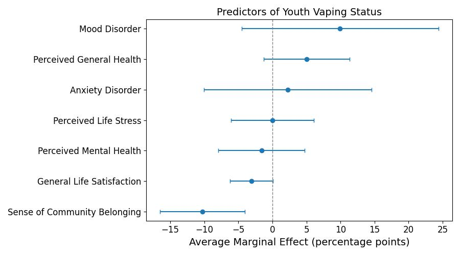

## Summary

- A *weakened* sense of youth community belonging was associated with *reductions* in the likelihood of self-reported e-cigarette use in the last month.

- Higher life satisfaction was marginally associated with a lower likelihood of use in the past month.

- Other variables like perceived mental health, perceived stress, and presence of an anxiety or mood disorder did not significantly relate to changes in predicted probability of e-cigarette use.

- Two machine learning classifiers performed modestly above chance when discriminating between current and past e-cigarette users.

- Additional measures beyond the psychological variables examined here appear necessary to assess how Canadian youth use e-cigarettes once they've tried them.

## Introduction

Research has explored the factors associated with high vaping prevalence in Canada [@millerCanadaHasHighest2023]. Alcohol and cannabis use, or recent school absences correlate with daily e-cigarette use [@shiMachineLearningApproach2022]. How might data reflecting the psychological well-being of youth respondents relate to their likelihood to vape? This project explores several variables that may be associated with the probability of a young person recently using an e-cigarette after they've tried it once.

## Data Description

This project uses data from the [Canadian Community Health Survey: Public Use Microdata File](https://doi.org/10.25318/82m0013x-eng). The data are from the 2022 report, and are based on reports from over 130,000 people across Canada age 12+. This project included data from 447 youth respondents. 

## Methodology

Only data from youth respondents (aged 12–17) were analyzed. The binary outcome variable was whether a youth respondent had used an e-cigarette at least once over the past month. Crucially, respondents must have tried an e-cigarette once in their life. Here, use in the last month makes a respondent a "current user" while no past-month use deems a respondent a "past user".

The two classes were reasonably balanced (55% past, 45% current). Several continuous and binary variables were investigated to explore their association with the probability of the outcome. For a concise presentation of these predictor variables, refer to the left side of *Figure 1*.

The youth sample was queried from the full microdata file using SQL, via the `duckdb` library. Subsequent cleaning, modelling, and visualization was done in Python. The complete analysis code can be viewed as an HTML file [here](https://github.com/cartermsmith/predictors-youth-vaping).

A logistic regression (LR) (fit with `statsmodels`) was used to uncover associations. Subsequently, to explore whether associations were hidden by using a linear model, I implemented a random forest ML algorithm (RF) and LR (fit with `sklearn`). These latter models were used for classification.

## Findings

An LR revealed a significant relation between sense of belonging and e-cigarette use. Each single-unit increase (getting *worse*) in self-reported sense of community belonging was associated with a 10.3 percentage point reduction in the likelihood of e-cigarette use. Further, when general life satisfaction increased by one unit (getting *better*), this likelihood decreased by 3.1 percentage points, although this finding was marginal (see *Figure 1*). None of the other predictors were significantly associated with the outcome.

Both classifiers performed modestly above chance when discriminating between current and past e-cigarette users (AUC ~.57-.60). These psychological predictors carry little information when predicting vaping status at the individual level.

## Conclusion

There is an association between recent e-cigarette use and youth sense of belonging: as belonging gets worse, e-cigarette use also trends downwards. Neither machine learning approach learned much from the predictors, suggesting that these psychological variables are themselves not adequate to classify current users from past users.

## Limitations & Next Steps

The current analysis is limited by the data being cross-sectional. These data are a snapshot in time, and because of this, cause and effect cannot be separated from one another. Thus, the effects observed above merely suggest that weaker belonging and lower e-cigarette use *co-occur* with each other.

This analysis did not use survey weights, meaning that the conclusions made here apply to the current sample rather than Canadian youth writ-large. Sex and age were also not controlled for.

Speculatively, it's interesting that *weakened* youth sense of belonging is associated with reduced e-cigarette use. This could suggest that e-cigarette use is more common in social settings, perhaps done with friends. The data cannot speak to this directly, but future work exploring this counterintuitive direction might elucidate how peer influence, for instance, shapes vape use.

**Revision note: November 2026**

An earlier version of this brief included errors that have since been corrected in this version. The direction of the sense-of-belonging measure was reported incorrectly. Collinearity conclusions were incorrect due to an oversight in the Python code. The cross-sectional structure of the data was not adequately acknowledged, with causal language included.